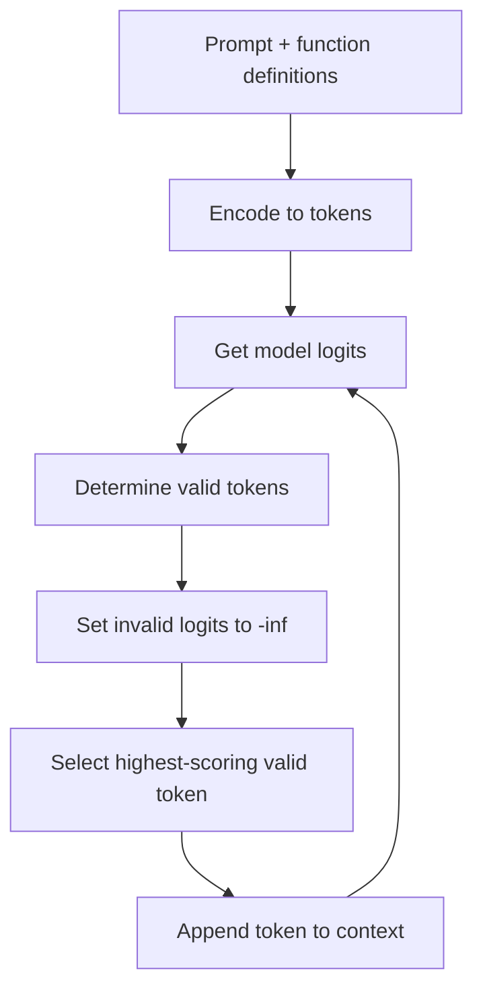

*This project has been created as part of the 42 curriculum by abait-el.*

# call-me-maybe

## Description

`call-me-maybe` is a function-calling system for large language models.

The program takes natural-language prompts and a list of available functions
with their parameter types. It uses `Qwen/Qwen3-0.6B` to select the most
appropriate function and generate its arguments.

The main goal of the project is to implement function calling using
**constrained decoding** instead of relying only on prompting the model to
produce valid JSON.

The generated result has the following structure:

```json
{
  "prompt": "...",
  "name": "...",
  "parameters": {}
}
```

The project combines a language model, function definitions, token-level
constraints, type-specific generation, and Pydantic validation to produce
structured function-call results.

## Instructions

### Installation

Install the project dependencies with:

```bash
make install
```

Equivalent command:

```bash
uv sync
```

### Usage

Run the program with the default input and output paths:

```bash
make run
```

Equivalent command:

```bash
uv run python -m src
```

Optional arguments:

```text
--functions_definition <function_definition_file>
--input <input_file>
--output <output_file>
```

Default paths:

| Argument                 | Default                                     |
| ------------------------ | ------------------------------------------- |
| `--functions_definition` | `data/input/functions_definition.json`      |
| `--input`                | `data/input/function_calling_tests.json`    |
| `--output`               | `data/output/function_calling_results.json` |

### Example Usage

Using the default files:

```bash
make run
```

Using custom files:

```bash
uv run python -m src \
    --functions_definition data/input/functions_definition.json \
    --input data/input/function_calling_tests.json \
    --output data/output/function_calling_results.json
```

The output is written to:

```text
data/output/function_calling_results.json
```

## Algorithm Explanation

The project generates function calls token by token.

The general process is:



### Function Selection

The available function names are encoded into token IDs.

`choose_tool()` generates the function name one token at a time. At every
step, it keeps only token IDs that can continue at least one of the available
function names.

This creates a prefix constraint:

```text
Available function names
        |
        v
Tokenized function names
        |
        v
Generated prefix
        |
        v
Valid continuations only
        |
        v
Highest-scoring valid token
```

This allows the LLM to choose the function while preventing it from generating
a function name that is not present in the provided definitions.

### Parameter Generation

After a function is selected, `FunctionCaller._generate_value()` chooses a
generation strategy according to the parameter type.

```text
string
    -> generate_string()

boolean
    -> generate_boolean()

integer
    -> generate_number() -> int()

number
    -> generate_number() -> float()
```

Numbers are generated using vocabulary tokens compatible with numeric
characters and configured number-ending tokens.

Strings are generated until a double quote is encountered.

Booleans are selected by comparing the model's scores for `true` and `false`.

### Token Masking

`choose_best_token()` creates a score list initialized with negative infinity:

```python
masked_logits = [float("-inf")] * len(logits)
```

It then restores the original logits only for allowed token IDs.

This means invalid tokens cannot be selected as the highest-scoring token.

## Design Decisions

### `LanguageModel`

`LanguageModel` provides a small project-specific interface around the provided
`Small_LLM_Model`.

It exposes the operations required by the decoder:

* encoding;
* decoding;
* obtaining logits;
* accessing vocabulary information.

This keeps the rest of the project independent from direct SDK calls.

### `FunctionCaller`

`FunctionCaller` is the high-level coordinator of function calling.

It combines:

* the available `ToolDefinition` objects;
* the `LanguageModel`;
* the prompt-building logic;
* the constrained decoder.

The application can therefore call:

```python
caller.generate(prompt)
```

without handling token generation directly.

### Pydantic Models

Pydantic is used for the application's structured data:

* `ValueType`
* `ToolDefinition`
* `PromptRecord`
* `CallRecord`

This provides explicit schemas and validation for both input data and
generated results.

### Separate Decoder Functions

The decoder keeps function selection and value generation in separate
functions:

* `choose_tool()`
* `generate_number()`
* `generate_string()`
* `generate_boolean()`

This keeps the token-generation logic explicit and easier to follow.

### Dynamic Function Definitions

Function definitions are read from `functions_definition.json` rather than
hardcoding the available functions into the implementation.

The same decoding mechanism can therefore work with different function
definitions.

## Performance Analysis

The project targets the performance requirements defined by the subject:

* 90%+ function-selection and argument-extraction accuracy;
* valid JSON and schema-compliant results;
* processing the test prompts in under 5 minutes on standard hardware;
* graceful handling of malformed input, missing files, and edge cases.

The implementation performs several model calls during token-by-token
generation. Function names and parameter values are generated incrementally,
which is necessary for the constrained-decoding approach.

The current implementation also performs some repeated work, such as encoding
the available function names and rebuilding the instruction for each prompt.

## Challenges Faced

The main challenge is producing structured function calls with a relatively
small language model.

Prompting the model alone does not provide reliable structural control, so the
project uses constrained decoding to restrict the possible next tokens.

Another challenge is that different parameter types require different
generation strategies. Numbers, strings, and booleans therefore use separate
decoder functions.

The project also needs to work with token IDs and the model vocabulary rather
than only normal Python strings, which makes the generation process more
low-level than ordinary text generation.

## Testing Strategy

The project can be tested with the provided input files:

```bash
make run
```

The generated file can then be checked at:

```text
data/output/function_calling_results.json
```

Testing should verify:

* the output is valid JSON;
* every result contains `prompt`, `name`, and `parameters`;
* selected function names exist in the provided definitions;
* required parameters are present;
* parameter types match their definitions;
* different function definitions can be supplied;
* prompts with different parameter types are handled;
* malformed JSON input is handled;
* missing input files are handled;
* functions with multiple parameters are handled.

## Resources

* Python documentation — Python language and standard library reference.
* Pydantic documentation — data validation and model definitions.
* `uv` documentation — Python project and dependency management.
* Qwen documentation and model information — background on
  `Qwen/Qwen3-0.6B`.
* The project subject: **call me maybe — Introduction to function calling in
  LLMs**, version 1.5.

### AI Usage

AI was used to:

* understand LLM and constrained-decoding concepts;
* understand the provided `llm_sdk`;
* review and simplify the project structure;
* improve the documentation.

All suggestions were reviewed and understood before being used.
